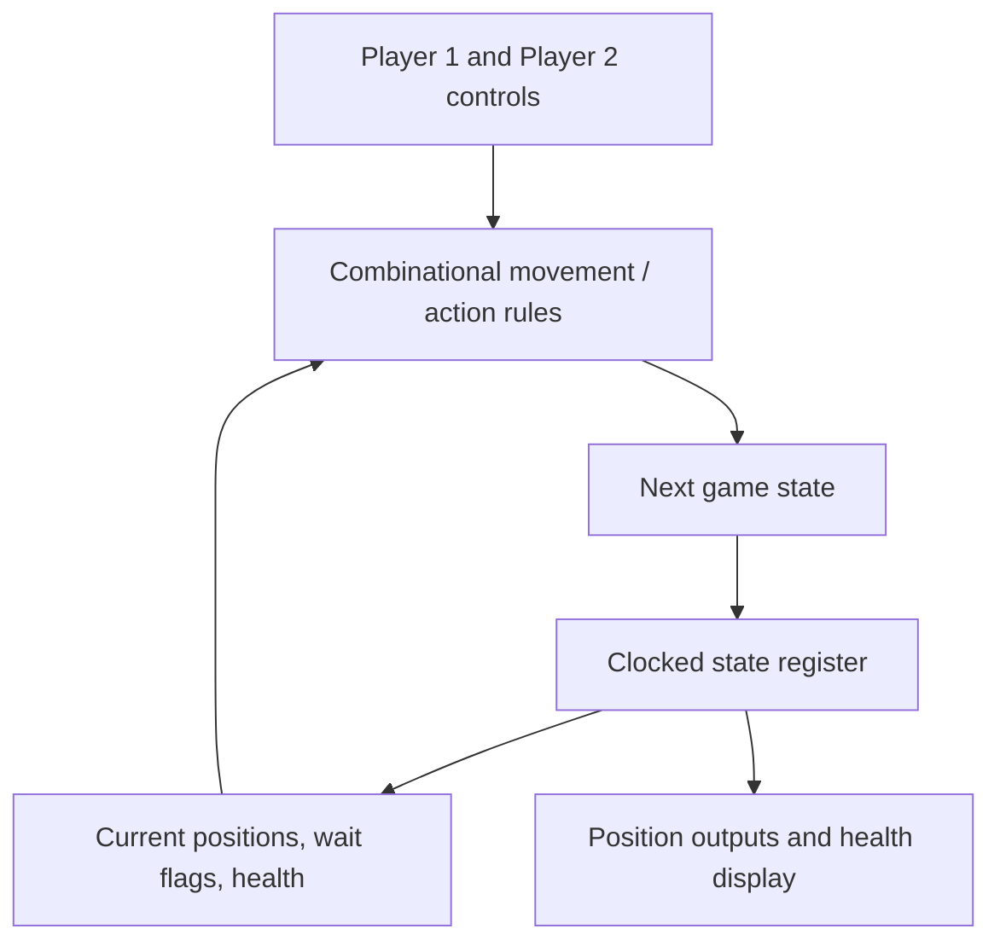

# Two-Player Fighting Game — Verilog / FPGA Coursework

**Digital logic · HDL state machines · Two-player game controls**

A Verilog project modeling a simplified two-player fighting game. The source includes input signals for movement, jumping, punching, kicking, and waiting, plus position, health, and seven-segment display logic.

## Intended state-update flow

The `game.v` module stores a packed game state and derives next-state updates from player actions, proximity, and remaining health. The testbench `game_tb.v` specifies an input-action sequence and requests a VCD waveform dump.

## Files and pre-existing artifacts

| Location | Purpose |
| --- | --- |
| [`game.v`](./simple_fighte_game/game.v) | Main game state and action logic |
| [`game_tb.v`](./simple_fighte_game/game_tb.v) | HDL testbench stimulus |
| [`tb_game.vcd`](./simple_fighte_game/tb_game.vcd) | Recorded waveform data from a historical simulation |
| [`result.vvp`](./simple_fighte_game/result.vvp) | Existing compiled simulation artifact |

### Example output: waveform

The repository includes [`tb_game.vcd`](./simple_fighte_game/tb_game.vcd), which can be inspected in a VCD waveform viewer such as GTKWave. The VCD file is a **historical artifact**, not proof that the current source builds cleanly.

## Verification status

**Current HDL and testbench have not been verified to compile.** A source inspection shows potential issues requiring correction before reliable simulation, including differences in the clock signal identifier (`CLK` versus `clk`), a malformed bit literal, and mismatches between module ports and positional testbench connections.

Once these are addressed, a suitable follow-up is a clean Icarus Verilog compile, simulation, and waveform comparison against the intended player-action sequence. This README intentionally does not claim a successful FPGA synthesis or hardware deployment.

## Learning scope

State-machine design, combinational action logic, clocked storage, testbench construction, and debugging signal-level behavior.
